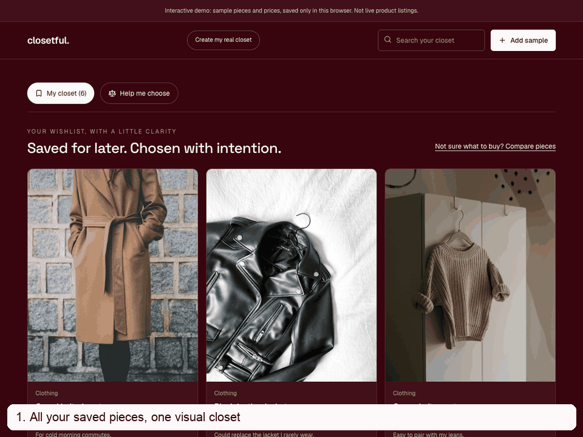
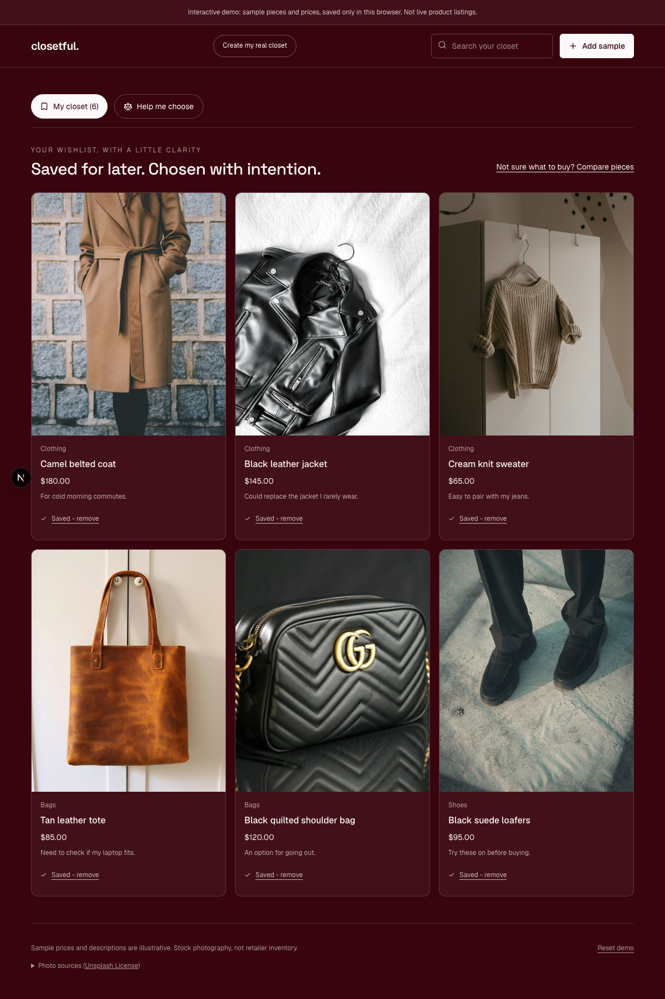
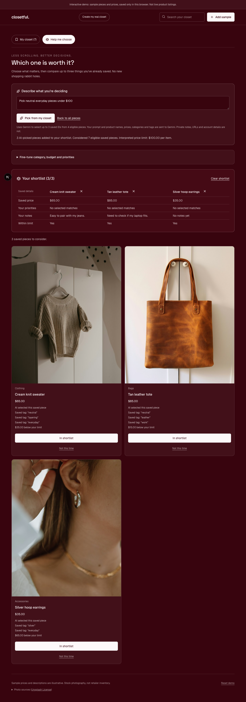
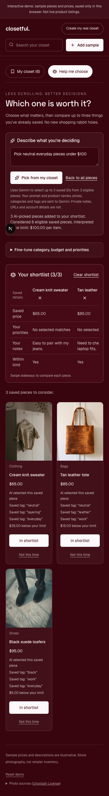

# Closetful

A full-stack shopping wishlist platform with a companion Chrome extension —
save products from any online store into a single, AI-organized closet.

## See it in action

[Watch the full demo recording](docs/media/closetful-demo.webm).
Recorded from the working `/demo` app with real Gemini responses.
All shown pieces, prices and notes are illustrative. Photos use the
[Unsplash License](https://unsplash.com/license); [photo credits](lib/demo-catalog.ts).

Desktop and mobile screenshots

**A visual wishlist with working product photos**

| Generative picking and comparison | Mobile experience |
| --- | --- |
|  |  |

## What it does

- **Generative retrieval from your own closet.** Describe what you want, such
  as "pick neutral everyday pieces under $100." Gemini directly generates
  IDs from an eligible saved-item catalog and creates a shortlist.
  Prices and tags come from saved records, not generated claims.
- **Help me choose.** Compare up to three saved pieces, filter by a per-item
  budget, and rank by the saved tags you explicitly pick. Suggestions explain
  their matches; they do not claim to know quality, reviews, or live prices.
- **Save from anywhere.** Paste a product URL, use the drag-to-bookmarks
  bookmarklet, or install the companion Chrome extension to save an item
  with one click from the product page itself.
- **AI auto-categorization.** Every saved item is automatically categorized
  (clothing, shoes, makeup, skincare, tech, etc.) and tagged using Google
  Gemini with JSON-schema-constrained structured output.
- **Bypasses bot-protected sites.** The Chrome extension reads product data
  directly from the page DOM in the user's own browser, sidestepping
  server-side anti-bot protection (Akamai, DataDome) that blocks
  traditional scraping on sites like Sephora and Etsy.
- **Brand filtering + search** across your saved closet.
- **Auto-login bridge.** Logging into the web app automatically signs the
  Chrome extension in too, via Chrome's `externally_connectable` messaging
  — no separate login required.

## Try the prototype

Run `npm install`, then `npm run dev`, and open `http://localhost:3000/demo`. This no-login demo
uses illustrative pieces and locally hosted, licensed stock photos. Demo saves
persist in this browser only; they never write to a real user's closet.
The authenticated `/closet` also includes the decision/comparison view.

Set `GEMINI_API_KEY` in the server's `.env.local` to enable generative picking.
Without a working key, the app shows an explicit error and manual filters remain
available; it does not disguise rule-based results as AI picks.

### How generative picking works

1. The server verifies ownership (or uses only the fixed public sample catalog)
   and applies hard category and budget constraints.
2. Gemini receives the prompt and up to 40 eligible items' names, prices,
   categories and tags, under temporary catalog identifiers.
3. A JSON schema constrains generated picks to those identifiers. The server
   rejects unknown/duplicate IDs and out-of-budget picks, then maps accepted IDs
   back to saved products and attaches their actual tags.
4. The shopper reviews up to three picks side by side. No matches stay empty;
   invalid or unavailable model responses produce visible errors.

This is a small-catalog, grounded LLM selection prototype, not a trained
semantic-ID model such as TIGER. It does not train on purchase histories or use
a vector database. Stored private notes, product URLs, database identifiers and
account details are not sent to Gemini. The prompt itself is sent, so avoid
including sensitive information in it.

The current AI rate limiter is best-effort and per-instance. Public deployments
should use shared quotas/abuse controls before exposing anonymous demo AI at scale.

Product photos prefer Product JSON-LD and Amazon's main image over generic
social previews. For stores that block server requests, the bookmarklet captures
the main photo from the open product page. Re-save an existing item using its
original URL to update its photo, or use **Edit details** to correct it manually.

Run `npm test`, `npm run lint`, and `npm run build` for local checks.
`npm run test:e2e` exercises saves, recommendations, generative picking and API
checks, mobile photos, retries, and bookmarklet capture; it currently uses
installed Google Chrome. The automated AI tests stub provider responses;
the recorded demo was additionally verified against live Gemini.

## Tech stack

- **Frontend/Backend:** Next.js 16 (App Router, Server Actions, Route
  Handlers), TypeScript, Tailwind CSS
- **Database & Auth:** Supabase (Postgres with Row-Level Security,
  Supabase Auth)
- **AI:** Google Gemini (structured categorization and constrained catalog-ID generation)
- **Browser extension:** Chrome Extension (Manifest V3), vanilla JS +
  React popup, Parcel bundler

## Project structure

- `app/` — Next.js App Router pages, Server Actions, and API routes
- `lib/` — shared logic: scraping (`scrape.ts`), AI categorization
  (`categorize.ts`), grounded picking (`generative-retrieval.ts`), the shared
  save pipeline (`save-item.ts`), Supabase client helpers
- `supabase/migrations/` — database schema (items, collections) with RLS
  policies
- `proxy.ts` — Next.js 16's renamed `middleware.ts`; refreshes the Supabase
  session cookie, with the no-login sample demo bypassing auth

The Chrome extension lives in a separate repository
([universal-wishlist](https://github.com/ananyaaa-t/universal-wishlist))
since it has its own build tooling (Parcel) and ships independently of the
web app.
